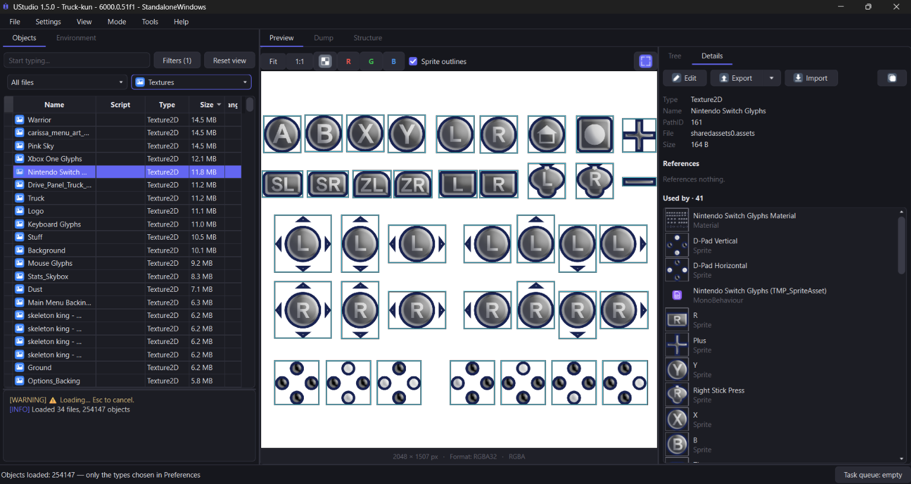
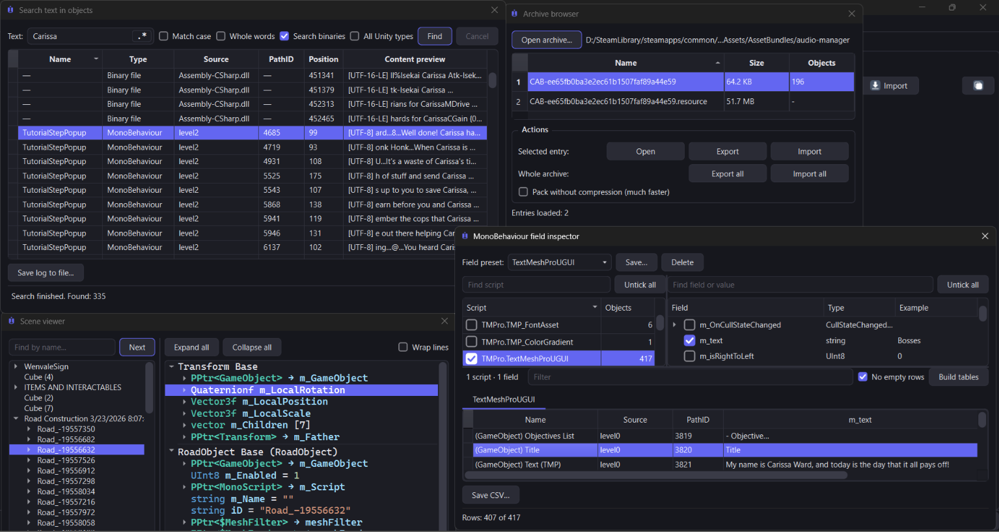

[](https://hits.sh/github.com/JunkBeat/UStudio/)
[](https://github.com/JunkBeat/UStudio/releases)
[](https://github.com/JunkBeat/UStudio/releases/latest)
[](https://github.com/JunkBeat/UStudio/releases/latest)

<h1>UStudio</h1>

<p>
  Browse, preview, export and patch the assets of Unity games.<br>
  Built for translators and modders.
  Written in Python, based on the <a href="https://github.com/K0lb3/UnityPy">UnityPy</a> library.
</p>

<table>
<tr>
<td width="50%"><br>Main Window</td>
<td width="50%"><br>Tools</td>
</tr>
</table>

<sub>UStudio v1.5.0.</sub>

## Features

- **Open any Unity game**: a game folder, `.assets`, bundles, `data.unity3d`, APKs.
  Unity 4 through Unity 6, Mono and IL2CPP, Windows, Linux, macOS, Android and unpacked Switch games.
- **Preview everything**: textures, sprites with atlas outlines, audio, video, fonts, text, 3D models with textures, and every field of every object.
- **Export and edit**: PNG, WAV, OBJ, TTF, JSON, TXT and raw dumps, one object or thousands at once.
- **Patch back**: import edited files, then save game files to a new folder or overwrite with automatic backups.
  Textures are re-encoded in their original format (BC1–BC7, ETC1/ETC2, ASTC and more).
- **Made for localization**: full-text search across all objects (regex included), TextMeshPro SDF font generation with character coverage checks, and a field inspector for MonoBehaviour translation tables.
- **IL2CPP games**: one click prepares the script layouts with the bundled Il2CppDumper.
- **Big games stay fast**: loads millions of objects and keeps the window responsive.
- **Command-line tool** (`ustudio_cli`) for scripts and mod installers.
- Dark and light themes.

## Running from source

Windows 10/11 with 64-bit Python 3.14.

```bash
pip install -r requirements.txt
python UStudio/main.py
```

Command-line tool:

```bash
python UStudio/ustudio_cli.py --help
```

BC texture encoding needs the .NET 6 runtime.

Two tools are not included because of their licences. Everything else works without them.

| For | Put these files | Into |
|---|---|---|
| Video conversion | `ffmpeg.exe`, `ffprobe.exe` from [ffmpeg.org](https://ffmpeg.org/download.html) | `UStudio/UnityPy/resources/ffmpeg/` |
| Audio import (FSB5) | `fmod.dll`, `fsbank.dll`, `libfsbvorbis64.dll` from the [FMOD Engine](https://www.fmod.com/download) 2.2 for Windows | `UStudio/UnityPy/resources/fsb5_converter/` |

The release builds already include both.

## Building

[Nuitka](https://nuitka.net) and the MSVC build tools produce the portable releases:

```bash
python build_GUI_portable.py
python build_CLI_portable.py
python prepare_release.py
```

## Project layout

| Folder | What's inside |
|---|---|
| `UStudio/` | The application: `main.py` (GUI), `ustudio_cli.py` (CLI), `core/` (logic without Qt) |
| `UStudio/UnityPy/` | Vendored [UnityPy](https://github.com/K0lb3/UnityPy) with our fixes |
| `native/` | Source of the native ETC encoder |
| `docs/` | User guides |
| `tests/` | Tests |
| `dev_scripts/` | Developer helpers |

## Development & AI Assistance

This project was made with heavy use of an AI coding assistant (Claude, through Claude Code), covering the implementation of the host application, GUI/CLI interfaces, and patches applied to the vendored UnityPy library.

**What was checked and how:**
- Functional validation and real-world game sample testing were coordinated with the AI assistant.
- Byte-level verifications and structural checks on patching mechanics within the vendored UnityPy components were performed by the AI during development to ensure correct asset re-encoding and game file saving.
- The software was manually spot-checked across various scenarios (loading, exporting, patching).

**What wasn't checked:**
- Internal variable names, code styles, types, and comments were largely generated by the AI without a rigorous line-by-line manual code audit by the maintainer.

This is an independent project. The AI-assisted work here is separate from upstream libraries (such as UnityPy), and their maintainers are not responsible for it. Please report any bugs or issues directly in this repository's issue tracker.

## Credits

UStudio stands on the shoulders of
[UnityPy](https://github.com/K0lb3/UnityPy),
[PyQt6](https://www.riverbankcomputing.com/software/pyqt/),
[NumPy](https://numpy.org),
[Pillow](https://python-pillow.github.io),
[BCnEncoder.NET](https://github.com/Nominom/BCnEncoder.NET),
[Compressonator](https://github.com/GPUOpen-Tools/compressonator),
[FSB5.Converter](https://github.com/JunkBeat/FSB5.Converter),
[msdfgen](https://github.com/Chlumsky/msdfgen),
[ffmpeg](https://ffmpeg.org),
[TypeTreeGeneratorAPI](https://github.com/UnityPy-Org/TypeTreeGeneratorAPI)
and [Il2CppDumper](https://github.com/Perfare/Il2CppDumper).

## License

UStudio is released under the [GNU General Public License v3.0](LICENSE).
The bundled UnityPy (MIT) and third-party tools keep their own licenses; see [THIRD-PARTY.txt](THIRD-PARTY.txt).

UStudio is not sponsored by or affiliated with Unity Technologies or its affiliates.
"Unity" is a registered trademark of Unity Technologies or its affiliates in the U.S. and elsewhere.
Only modify games you are allowed to.
